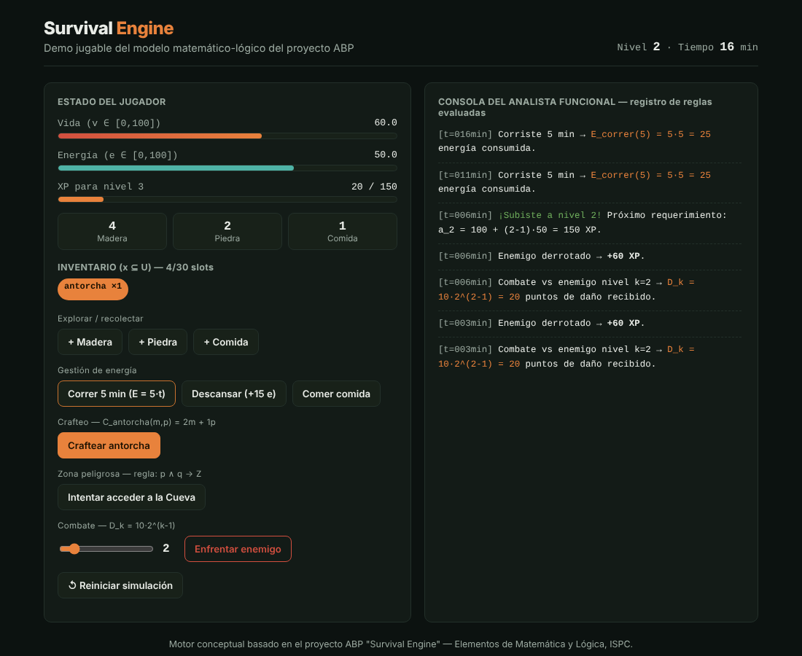
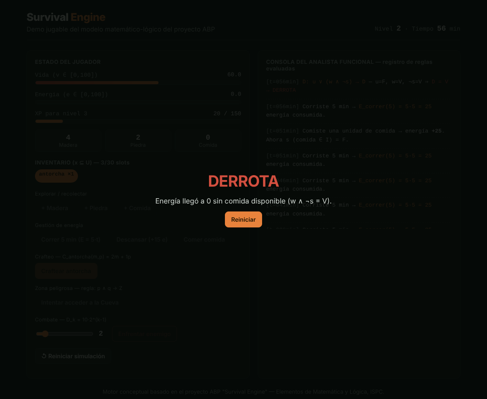

# Survival Engine

Modelo matemático y lógico de un videojuego de supervivencia, con una demo jugable que aplica cada fórmula y cada regla en tiempo real.

**Jugar la demo:** https://ricardokieffer.github.io/survival-engine/



## Qué problema resuelve

En los juegos de supervivencia, el jugador administra vida, energía e inventario frente a amenazas del entorno. Cuando esas reglas se escriben en lenguaje natural («el jugador tiene frío si está cansado y es de noche»), cada programador las interpreta distinto y aparecen errores típicos:

- **Ambigüedades:** reglas vagas que dependen de quién las programe.
- **Errores de tipo:** cantidades imposibles, como cargar 3,75 hachas en el inventario.
- **Desbalance:** dificultad que crece de forma arbitraria al subir de nivel.
- **Bugs de flujo:** entrar a zonas restringidas sin los ítems necesarios o saltarse la derrota.

Survival Engine especifica el comportamiento del juego con matemática y lógica formal, como lo haría un analista funcional antes de escribir código, y después lo implementa para comprobar que el modelo funciona.

## Cómo se ve el modelo en el juego

Cada acción de la demo aplica una parte del modelo, y la **consola del analista funcional** muestra qué fórmula o regla se evaluó y con qué valores:

| Acción en el juego | Modelo que aplica |
|---|---|
| Correr | Función de consumo de energía: `E(t) = 5·t` |
| Craftear antorcha | Función de costo: 2 de madera y 1 de piedra |
| Subir de nivel | Progresión aritmética: `aₙ = 100 + (n−1)·50` |
| Combatir | Progresión geométrica del daño: `Dₖ = 10·2^(k−1)` |
| Entrar a la cueva | Regla lógica: `p ∧ q → Z` (energía ≥ 50 y tiene antorcha) |
| Alerta de cansancio | Regla lógica: `r ∧ ¬s → A` (energía < 20 y sin comida) |
| Derrota | Regla lógica: `u ∨ (w ∧ ¬s) → D` (vida en 0, o energía en 0 sin comida) |
| Vida y energía | Dominio `[0, 100]` con truncamiento: nunca bajan de 0 ni pasan de 100 |

<p align="center"></p>

El modelo completo, con dominios, funciones, conjuntos, tablas de verdad, sistemas de ecuaciones y la matriz de casos de prueba, está en [docs/ESPECIFICACION.md](docs/ESPECIFICACION.md).

## Tres versiones del mismo modelo

| Archivo | Qué es | Cómo se usa |
|---|---|---|
| `index.html` | Demo jugable en el navegador | [Jugar online](https://ricardokieffer.github.io/survival-engine/) o abrir el archivo con doble clic |
| `src/survival_engine.py` | Motor en Python: implementa todo el modelo y ejecuta los 5 casos de prueba | `python src/survival_engine.py` |
| `src/survival_engine_console.py` | Versión jugable por teclado en la terminal | `python src/survival_engine_console.py` |

Las versiones en Python usan solo la biblioteca estándar: no hace falta instalar nada.

Salida del motor al ejecutar los casos de prueba (fragmento):

```
[Sistema 2x2 - Balance de crafteo]
  Antorchas: 20.0, Picos de piedra: 5.0

[Tabla de verdad - Regla de acceso a Zona Peligrosa]
  p=True  q=True  -> Z=True

--- Caso 5: Crítico y derrota por inanición ---
Estado inicial: v=10, e=0, x=0, n=2, t=30, inventario=set()
Estado final:   v=10, e=0, x=0, t=30 -> DERROTA (Game Over)
```

## Tecnologías y temas

- **Python 3:** clases, `dataclasses`, tipado y funciones puras para cada parte del modelo.
- **HTML, CSS y JavaScript** sin frameworks para la demo, con tema claro y oscuro y diseño adaptable al celular.
- **Matemática aplicada:** intervalos y dominios, funciones lineales, cuadráticas y compuestas, progresiones aritméticas y geométricas, lógica proposicional con tablas de verdad, teoría de conjuntos, regla de Cramer (sistema 2×2) y sustitución (sistema 3×3).

## Estructura

```
/
├── index.html                       # Demo jugable (publicada con GitHub Pages)
├── src/
│   ├── survival_engine.py           # Motor y matriz de casos de prueba
│   └── survival_engine_console.py   # Versión de consola
└── docs/
    ├── ESPECIFICACION.md            # Modelo matemático y lógico completo
    └── capturas/                    # Imágenes para este README
```

## Equipo

Proyecto integrador de **Elementos de Matemática y Lógica**, Tecnicatura Superior en Desarrollo de Software (ISPC), 2026. Desarrollado por el Grupo 45: **Ricardo Kieffer**, Joaquín Bileisis, Axel Luna, Sandra Belén y Juan Lobos.

**Contacto:** [LinkedIn](https://www.linkedin.com/in/ricardo-kieffer) · [GitHub](https://github.com/ricardokieffer)
